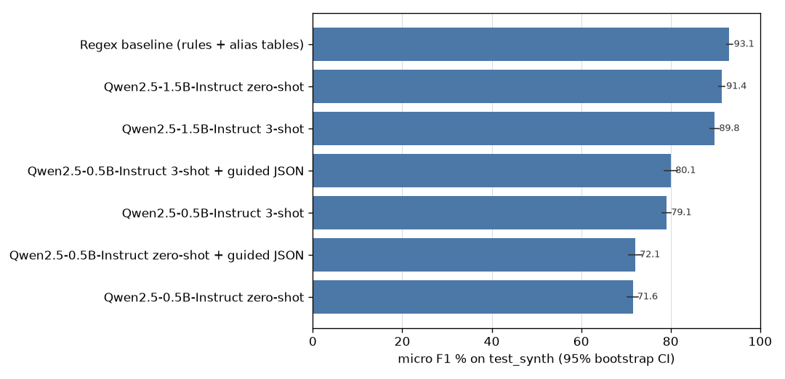
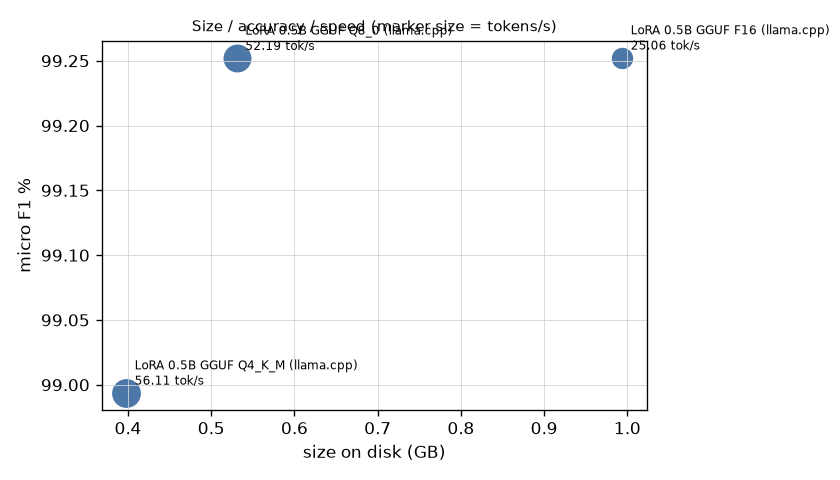

# jobpost-extractor-qlora

[](https://github.com/srini2k03/jobpost-extractor-qlora/actions/workflows/ci.yml)

Messy Indian job postings in, one strict JSON object out.

**Headline route:** a LoRA fine-tune of Qwen2.5-0.5B-Instruct, trained on CPU in GitHub Actions.
- Everything runs on free GitHub-hosted runners: data, baselines, training, quantisation, evaluation,
  release and demo. It needs no GPU and no accounts beyond GitHub.
- It is compared with prompting baselines (0.5B and 1.5B, zero/3-shot, free and JSON-grammar decoding), a
  rule-based baseline and a larger API model, GPT-OSS-120B via Groq.
- The model files (adapter, merged weights, GGUF) are published by `cpu-eval-release`: as the GitHub Release
  [`model-v1`](https://github.com/srini2k03/jobpost-extractor-qlora/releases/tag/model-v1) when the workflow
  token may create releases, otherwise as that run's `model-v1-files` artifact. The Q4_K_M model runs in your browser in the
  **[live demo](https://srini2k03.github.io/jobpost-extractor-qlora/)**.

A QLoRA 1.5B GPU path (Colab or a local GPU) is provided but **not run**; see
[`docs/gpu_route.md`](docs/gpu_route.md).

> **Status.** Rows marked "pending CPU run" fill in as the workflows below run; nothing in this README is
> estimated. Model card: [`MODEL_CARD.md`](MODEL_CARD.md).

```text
🔥 Hiring!! Sr. Python Developer @ Kaveri Analytics Pvt Ltd
Exp: 4-7 yrs | CTC 18-24 LPA
Loc: Bangalore / Pune (Hybrid)
Must know Django, AWS, PostgreSQL, Docker
B.Tech/B.E. preferred. Call HR 9876543210. Joining kit worth ₹500!
```

Target output (what the model is trained to produce):

```json
{"company": "Kaveri Analytics", "role": "Python Developer", "seniority": "senior",
 "skills": ["python", "django", "aws", "postgresql", "docker"],
 "min_experience_years": 4, "max_experience_years": 7,
 "salary": {"min": 1800000, "max": 2400000, "currency": "INR", "period": "year"},
 "locations": ["Bengaluru", "Pune"], "work_mode": "hybrid", "employment_type": null, "education": "b.tech"}
```

- Fields the posting does not state are `null` (or `[]`), never guessed; here no employment type is stated.
- The phone number and the ₹500 kit are distractors.
- Schema: [`src/jobx/schema/models.py`](src/jobx/schema/models.py), exported as
  [`schema/jobposting.schema.json`](schema/jobposting.schema.json).

## Results

All tables are generated by `jobx results-table` from the prediction files in `results/predictions/`; CI
regenerates them and fails if the committed copy is stale. Percentages, with 95% bootstrap CIs (1,000
resamples of examples).

<!-- RESULTS:START -->
#### Real postings (`test_real`, headline)

_The real test set is pending: it needs real postings fetched, draft labels and a human pass with `jobx verify` (see `docs/real_dataset.md`)._

| Approach | Hardware | n | JSON valid % | Schema valid % | Field EM % | Micro F1 % [95% CI] | Macro F1 % | Hallucination % [95% CI] | Status |
|---|---|---|---|---|---|---|---|---|---|
| Regex baseline (rules + alias tables) | CPU | - | - | - | - | - | - | - | pending (needs this split) |
| Qwen2.5-0.5B-Instruct zero-shot | CPU (GitHub Actions) | - | - | - | - | - | - | - | pending CPU run |
| Qwen2.5-0.5B-Instruct zero-shot + guided JSON | CPU (GitHub Actions) | - | - | - | - | - | - | - | pending CPU run |
| Qwen2.5-0.5B-Instruct 3-shot | CPU (GitHub Actions) | - | - | - | - | - | - | - | pending CPU run |
| Qwen2.5-0.5B-Instruct 3-shot + guided JSON | CPU (GitHub Actions) | - | - | - | - | - | - | - | pending CPU run |
| Qwen2.5-1.5B-Instruct zero-shot | CPU (GitHub Actions) | - | - | - | - | - | - | - | pending CPU run |
| Qwen2.5-1.5B-Instruct 3-shot | CPU (GitHub Actions) | - | - | - | - | - | - | - | pending CPU run |
| Qwen2.5-0.5B LoRA fine-tune (ours), GGUF F16 | CPU (GitHub Actions) | - | - | - | - | - | - | - | pending CPU run |
| Qwen2.5-0.5B LoRA fine-tune (ours), GGUF Q8_0 | CPU (GitHub Actions) | - | - | - | - | - | - | - | pending CPU run |
| Qwen2.5-0.5B LoRA fine-tune (ours), GGUF Q4_K_M (browser demo) | CPU (GitHub Actions) | - | - | - | - | - | - | - | pending CPU run |
| GPT-OSS-120B via Groq (API, few-shot) | Groq API (free tier) | - | - | - | - | - | - | - | pending API run |

_15 optional GPU-route rows (1.5B/7B baselines, 1.5B QLoRA, AWQ; need a GPU plus Hugging Face and W&B accounts) were not run; see `docs/gpu_route.md`._

#### Synthetic held-out families and companies (`test_synth`)

| Approach | Hardware | n | JSON valid % | Schema valid % | Field EM % | Micro F1 % [95% CI] | Macro F1 % | Hallucination % [95% CI] | Status |
|---|---|---|---|---|---|---|---|---|---|
| Regex baseline (rules + alias tables) | CPU | 471 | 100.0 | 100.0 | 91.1 | 93.1 [92.5, 93.8] | 90.8 | 2.5 [1.7, 3.2] | measured 2026-11-03 @902cc8a |
| Qwen2.5-0.5B-Instruct zero-shot | CPU (GitHub Actions) | 471 | 96.2 | 0.0 | 54.2 | 71.6 [70.4, 72.7] | 56.2 | 67.1 [64.2, 69.8] | measured 2026-11-03 @971e1dc |
| Qwen2.5-0.5B-Instruct zero-shot + guided JSON | CPU (GitHub Actions) | 200 | 99.5 | 77.5 | 54.7 | 72.1 [70.6, 73.6] | 54.5 | 73.0 [69.4, 76.6] | measured 2026-11-03 @971e1dc |
| Qwen2.5-0.5B-Instruct 3-shot | CPU (GitHub Actions) | 471 | 99.4 | 23.6 | 66.0 | 79.1 [78.1, 80.0] | 65.1 | 43.7 [41.4, 46.4] | measured 2026-11-03 @971e1dc |
| Qwen2.5-0.5B-Instruct 3-shot + guided JSON | CPU (GitHub Actions) | 200 | 99.0 | 99.0 | 66.5 | 80.1 [78.5, 81.4] | 66.2 | 44.2 [40.6, 48.1] | measured 2026-11-03 @971e1dc |
| Qwen2.5-1.5B-Instruct zero-shot | CPU (GitHub Actions) | 471 | 100.0 | 5.1 | 84.4 | 91.4 [90.8, 92.1] | 86.0 | 35.3 [32.6, 37.6] | measured 2026-11-03 @971e1dc |
| Qwen2.5-1.5B-Instruct 3-shot | CPU (GitHub Actions) | 471 | 97.5 | 40.3 | 84.0 | 89.8 [88.8, 90.8] | 85.8 | 21.7 [19.8, 23.7] | measured 2026-11-03 @971e1dc |
| Qwen2.5-0.5B LoRA fine-tune (ours), GGUF F16 | CPU (GitHub Actions) | 471 | 100.0 | 99.6 | 98.8 | 99.3 [99.1, 99.5] | 99.0 | 1.9 [1.2, 2.6] | measured 2026-11-04 @fcdc48b |
| Qwen2.5-0.5B LoRA fine-tune (ours), GGUF Q8_0 | CPU (GitHub Actions) | 471 | 100.0 | 99.8 | 98.8 | 99.3 [99.1, 99.5] | 98.9 | 1.7 [1.0, 2.3] | measured 2026-11-04 @fcdc48b |
| Qwen2.5-0.5B LoRA fine-tune (ours), GGUF Q4_K_M (browser demo) | CPU (GitHub Actions) | 471 | 100.0 | 99.8 | 98.5 | 99.0 [98.8, 99.2] | 98.5 | 2.0 [1.3, 2.7] | measured 2026-11-04 @fcdc48b |
| GPT-OSS-120B via Groq (API, few-shot) | Groq API (free tier) | - | - | - | - | - | - | - | incomplete (137/200) |

_15 optional GPU-route rows (1.5B/7B baselines, 1.5B QLoRA, AWQ; need a GPU plus Hugging Face and W&B accounts) were not run; see `docs/gpu_route.md`._

#### Per-field exact match % (`test_synth`)

| Approach | company | role | seniority | skills | min_experience_years | max_experience_years | salary | locations | work_mode | employment_type | education |
|---|---|---|---|---|---|---|---|---|---|---|---|
| Regex baseline (rules + alias tables) | 48.2 | 75.4 | 79.2 | 99.4 | 100.0 | 100.0 | 100.0 | 100.0 | 100.0 | 100.0 | 100.0 |
| Qwen2.5-0.5B-Instruct zero-shot | 84.7 | 93.6 | 42.3 | 77.1 | 25.7 | 29.3 | 52.4 | 67.7 | 57.5 | 49.0 | 17.0 |
| Qwen2.5-0.5B-Instruct zero-shot + guided JSON | 88.0 | 96.0 | 44.5 | 90.0 | 21.0 | 25.0 | 54.5 | 70.0 | 56.5 | 49.5 | 6.5 |
| Qwen2.5-0.5B-Instruct 3-shot | 55.6 | 97.7 | 51.2 | 74.5 | 92.4 | 86.2 | 52.0 | 70.1 | 49.5 | 44.6 | 51.8 |
| Qwen2.5-0.5B-Instruct 3-shot + guided JSON | 61.0 | 96.0 | 46.5 | 74.5 | 89.0 | 82.5 | 51.5 | 70.0 | 60.0 | 53.0 | 47.0 |
| Qwen2.5-1.5B-Instruct zero-shot | 83.4 | 99.2 | 78.6 | 98.1 | 93.6 | 89.2 | 80.5 | 92.6 | 66.7 | 62.2 | 84.1 |
| Qwen2.5-1.5B-Instruct 3-shot | 86.6 | 97.2 | 74.7 | 81.1 | 93.2 | 87.9 | 76.4 | 89.2 | 77.1 | 68.8 | 91.9 |
| Qwen2.5-0.5B LoRA fine-tune (ours), GGUF F16 | 96.8 | 97.9 | 99.6 | 99.4 | 99.6 | 99.8 | 98.5 | 99.4 | 96.2 | 99.8 | 100.0 |
| Qwen2.5-0.5B LoRA fine-tune (ours), GGUF Q8_0 | 96.8 | 97.9 | 99.6 | 99.4 | 99.8 | 100.0 | 98.1 | 99.4 | 96.4 | 99.8 | 100.0 |
| Qwen2.5-0.5B LoRA fine-tune (ours), GGUF Q4_K_M (browser demo) | 96.6 | 98.1 | 99.4 | 99.4 | 99.8 | 100.0 | 95.8 | 99.4 | 95.5 | 99.8 | 100.0 |

#### Incomplete runs (not part of the comparison above)

Partial runs, or runs with more than 5% failed requests, are scored on what completed and shown here only.

| Approach | Split | Status | Error rate % | n scored | Micro F1 % | JSON valid % |
|---|---|---|---|---|---|---|
| GPT-OSS-120B via Groq (API, few-shot) | test_synth | incomplete (137/200) | 0.0 | 137 | 98.1 | 100.0 |

#### API usage

| Approach | Split | Model | Requests | Input tokens | Output tokens | Cost (USD) |
|---|---|---|---|---|---|---|
| GPT-OSS-120B via Groq (API, few-shot) | test_synth | `openai/gpt-oss-120b` (137) | 137 | 251942 | 66750 | 0.00 |

#### Size / speed / accuracy trade-off

| Variant | Hardware | Size (GB) | Micro F1 % | Tokens/s | Peak memory (GB) | Status |
|---|---|---|---|---|---|---|
| LoRA 0.5B GGUF F16 (llama.cpp) | CPU (INTEL(R) XEON(R) PLATINUM 8573C, 4 threads, GitHub Actions) | 0.994 | 99.3 | 25.06 | 1.042 | measured 2026-11-04 |
| LoRA 0.5B GGUF Q8_0 (llama.cpp) | CPU (AMD EPYC 7763 64-Core Processor, 4 threads, GitHub Actions) | 0.531 | 99.3 | 52.19 | 0.611 | measured 2026-11-04 |
| LoRA 0.5B GGUF Q4_K_M (llama.cpp) | CPU (AMD EPYC 7763 64-Core Processor, 4 threads, GitHub Actions) | 0.398 | 99.0 | 56.11 | 0.514 | measured 2026-11-04 |
<!-- RESULTS:END -->

**About the regex baseline.** It is a real CPU run, but read it as a sanity check of the evaluation stack
rather than a competitor. Its patterns were written with all synthetic templates in view (including the
held-out families), and it shares alias tables and salary/experience parsers with the generator. So
`test_synth` flatters it. Company and role, the fields its patterns can't pin down, are where it fails
(see `notebooks/06_error_analysis.ipynb`). The real-postings split is the honest comparison.

**About the regex baseline.** It is a real CPU run, but read it as a sanity check of the evaluation stack
rather than a competitor. Its patterns were written with all synthetic templates in view (including the
held-out families), and it shares alias tables and salary/experience parsers with the generator. So
`test_synth` flatters it. Company and role, the fields its patterns can't pin down, are where it fails
(see `notebooks/06_error_analysis.ipynb`). The real-postings split is the honest comparison.

### Charts and training curves

_These images appear after the first CPU-route runs; `jobx charts` draws them from `results/results.json`._





The CPU fine-tune writes its curves (train/validation loss, learning rate, validation JSON micro F1) to
[`results/training/qwen2.5-0.5b-lora-cpu/`](results/training/qwen2.5-0.5b-lora-cpu/) as PNG and JSON after
every job. This replaces W&B.


## How it works

**Data** ([`DATA_CARD.md`](DATA_CARD.md), generated from real statistics of the committed set)
1. *Synthetic, labels by construction.* A structured record is sampled first from Indian job-market
   vocabularies: 18 role domains, 143 skills with aliases, 35 cities with aliases, salary bands by
   seniority in LPA or per month, experience ranges and fictional company names. The record is then
   rendered through alias tables, 12 template families (Naukri-style, LinkedIn prose, WhatsApp forward,
   consultancy mail, walk-in drive, Telegram channel, Hinglish chat...) and noise operators: typos,
   abbreviations, emojis, bullets, shuffled sections, HTML remnants, Hinglish fragments and distractors such as
   phone numbers, "₹500 joining kit", referral bonuses, notice periods, "in business for 15 years" and a
   "headquartered in <other city>" trap.
2. *Recoverability checker* (`src/jobx/data/validate.py`): every gold value must be findable in the text
   with the same parsers the evaluator uses. Paraphrases must also introduce nothing new. An optional NLI
   hook adds an entailment check per field. On the current set it rejects 0 of 3,000 generated postings,
   after it caught a real template bug during development.
3. *LLM paraphrase pass* (7B teacher): part of the optional GPU route, not run. The checker and filter are
   in place for it.
4. *MinHash near-duplicate removal* (word 3-gram shingles, 128 permutations, LSH 32×4, exact-Jaccard
   confirmation). It keeps the test copy when a train item collides with it.
5. *Leakage-safe split*: template families **and** companies are disjoint across train / val / test_synth.
   This is verified in the build and in the tests.
6. *Real postings* (~200, from a permissively licensed HF dataset) with drafted labels checked by a
   human with `jobx verify`. This **real-only test split is the headline evaluation**. Pending; see
   [`docs/real_dataset.md`](docs/real_dataset.md).

**Baselines** (notebook 02): Qwen2.5-1.5B zero-shot and 3-shot and an optional Llama-3.2-1B. Each runs
with free decoding and with guided JSON decoding (lm-format-enforcer).

**Baselines (CPU route)** ([`cpu_baselines.yml`](.github/workflows/cpu_baselines.yml), settings in
[`configs/cpu/route.yaml`](configs/cpu/route.yaml)):
- Models: Qwen2.5-0.5B- and 1.5B-Instruct, downloaded from the public Hugging Face Hub with no token,
  converted to GGUF Q8_0 and served by llama.cpp on the runner's CPU.
- Settings: zero-shot and 3-shot, with the full instruction prompt. The 0.5B model also runs with
  **JSON-schema grammar** decoding ("guided"), on the same evenly spaced 200-posting subset the GPU route uses.
- Each (model, setting) is its own parallel job. llama.cpp's prompt cache reuses the shared system-prompt
  (and few-shot) prefix.

**Larger API model.** GPT-OSS-120B via Groq's free tier, 3-shot
([`openai_compat_runner.py`](src/jobx/baselines/openai_compat_runner.py),
[`api_baseline.yml`](.github/workflows/api_baseline.yml), secret `GROQ_API_KEY`).
- GPT-OSS-120B is OpenAI's open-weight model, a mixture-of-experts with about 117B parameters. Llama-3.3-70B
  was not available to the project's Groq key.
- The JSON Schema is sent as `response_format`, with a fallback to JSON mode and then to prompt-only.
- Free-tier handling:
  - client-side rate limiting at 25 requests/min;
  - 429 waits from `Retry-After` / `x-ratelimit-reset-*`;
  - a success-only response cache and resumable runs, with a daily schedule;
  - a model fallback chain;
  - token counts in the "API usage" table.
- Partial runs are shown as "incomplete (k/N)", never as results.

**LoRA fine-tune on CPU** ([`src/jobx/cpu/train.py`](src/jobx/cpu/train.py),
[`cpu_finetune.yml`](.github/workflows/cpu_finetune.yml)).
- **Recipe:** PEFT LoRA r=16/α=32 on all linear projections, TRL `SFTTrainer` with completion-only loss,
  effective batch 16, cosine LR 3e-4. Precision is fp32, or bf16 if the runner's CPU has AVX512-BF16/AMX.
  Torch uses all cores.
- **Short prompt:** the fine-tune uses a short system prompt (it learns the conventions from the data). That
  halves the sequence length:
  - estimated from character counts at about 330 tokens median and 420 at p99, so `max_length` is 512;
  - the first CI job measures the real lengths with the tokenizer, and records them in `plan.json`;
  - over-long examples are dropped, never truncated.
- **Planning:** the first job measures seconds per optimiser step on the runner. A planner then picks 2
  epochs, 1 epoch or a stratified subset so training fits ≤ 3 chained 5-hour jobs. The plan and its reason
  are committed to `results/training/qwen2.5-0.5b-lora-cpu/plan.json`.
- **Chaining:**
  - Each job stops at its time limit and checkpoints. It stores the state as an asset of the prerelease
    `cpu-train-state`, then dispatches the next job (a 6-hourly schedule resumes if a dispatch is lost).
  - Validation loss and JSON-F1 (greedy decoding on a val subset) are logged four times per run.
  - When training is done, the job dispatches the release workflow.
- Details: [`docs/hyperparameters.md`](docs/hyperparameters.md#cpu-route).

**Merge, quantise, evaluate, publish** ([`cpu_eval_release.yml`](.github/workflows/cpu_eval_release.yml)).
- The adapter is merged (fp16 safetensors) and converted with llama.cpp to GGUF F16, Q8_0 and Q4_K_M.
- Each quantisation is evaluated on every test split. A CPU benchmark records tokens/s, peak RAM, size and
  accuracy (the "size / speed / accuracy" table).
- Results are committed.
- The adapter, merged weights and GGUF files are uploaded as the `model-v1-files` artifact of the
  `cpu-eval-release` run, and also as the GitHub Release `model-v1` (with [`MODEL_CARD.md`](MODEL_CARD.md) as
  the notes) when the workflow token is allowed to create releases. Chained training jobs hand their state
  over through the `train-state` and `lora-adapter` artifacts.

**Live demo** ([`pages.yml`](.github/workflows/pages.yml)).
- The released Q4_K_M GGUF is split into < 95 MB parts and served from the `gh-pages` branch, because
  release downloads lack CORS.
- It runs in the visitor's browser with [wllama](https://github.com/ngxson/wllama) 3.8.1 (llama.cpp → WASM)
  and the JSON-schema grammar.
- The page has examples, a box to paste your own posting, the JSON output and field highlighting, next to the
  results table and charts.
- A Playwright check loads the model in headless Chromium and extracts valid JSON before every publish.

**Evaluation** ([`src/jobx/eval`](src/jobx/eval), CPU only, runs in CI on saved predictions)
- JSON validity (a parseable object), schema validity (validates against `JobPosting` exactly).
- Per-field exact match after normalisation: salary is compared as INR per annum (12 months, 2,080
  hours, 83 INR/USD) and rounded to ₹1,000, so "1.5L/month" equals "18 LPA". Skills and cities are
  canonicalised through alias tables. Company names drop legal suffixes, and roles drop seniority words.
- Precision/recall/F1 for scalar fields (a stated prediction is a TP if correct, else an FP; a stated gold
  value missed or wrong is an FN). For list fields (skills, locations) they are computed element-wise.
  Micro F1 pools all fields; macro F1 averages per-field F1.
- **Hallucination rate**: fields that are null in gold but filled in the prediction, divided by all gold-null
  fields.
- Bootstrap 95% CIs, and an automatic error taxonomy (`src/jobx/eval/taxonomy.py`): invalid JSON,
  truncation, schema-invalid, wrong salary unit, missed/spurious skill, hallucinated field, location
  confusion, seniority mismatch, experience/role/company errors.

**Serving** without the browser:
- FastAPI `POST /extract` ([`src/jobx/serve/app.py`](src/jobx/serve/app.py)) uses llama-cpp-python on any of
  the released GGUF files: `JOBX_GGUF_PATH=jobx-qwen2.5-0.5b-Q4_K_M.gguf uvicorn jobx.serve.app:app`. It
  validates against the schema and retries on invalid output.
- There is a Dockerfile in [`docker/`](docker/Dockerfile).
- Ollama: [`ollama/Modelfile`](ollama/Modelfile).
- Use the short prompt (`prompts.COMPACT_SYSTEM_PROMPT`) with the CPU fine-tune.

## Run it

Everything below runs in GitHub Actions (Actions tab → workflow → *Run workflow*). It needs no secrets
except `GROQ_API_KEY` for the API row. Dispatch in this order:

| # | Workflow | Runs | Produces |
|---|---|---|---|
| 1 | `cpu-baselines` | ~1–3 h (parallel jobs) | 0.5B/1.5B baseline predictions + metrics, committed |
| 2 | `cpu-finetune` | 1–3 chained ~5 h jobs, automatic | plan, checkpoints (prerelease `cpu-train-state`), curves; then dispatches 3 |
| 3 | `cpu-eval-release` | ~1–2 h, dispatched by 2 | fine-tune rows (F16/Q8_0/Q4_K_M), benchmark, model files (artifact, plus Release `model-v1` when permitted), `MODEL_CARD.md`; then dispatches 4 |
| 4 | `pages` | ~15–30 min, dispatched by 1 and 3 | the live demo + results site on GitHub Pages (branch `gh-pages`) |
| - | `api-baseline` | ~20–30 min/day until done | GPT-OSS-120B rows (resumes daily) |

To turn on Pages, go to Settings → Pages → *Deploy from a branch* → `gh-pages` / root (once).

Locally, on CPU:

```bash
pip install -e ".[dev,serve]"
jobx build-data          # 3,000 synthetic postings -> validate -> split -> dedup -> DATA_CARD.md
jobx regex-baseline      # predictions for the regex baseline
jobx eval                # metrics + bootstrap CIs for every predictions file
jobx results-table       # tables above + results/results.json
pytest && ruff check . && mypy
```

## Repository layout

```text
src/jobx/
  schema/        Pydantic schema, JSON Schema export, output parser
  vocab.py       skills / cities / degrees / enums with aliases, salary bands (shared by generator and evaluator)
  normalize/     salary -> INR p.a., experience parser, skill/city canonicalisation, field normalisers
  data/          generate, surface forms, templates, noise, validate, paraphrase, dedup, split, build, datacard, fetch_real
  cpu/           CPU route: training planner, resumable CPU LoRA training, job matrices, model card
  baselines/     regex extractor, API runners (Groq/Gemini/Anthropic), HF runner (GPU route)
  eval/          metrics, bootstrap, taxonomy, results tables, charts, curves, Pages site
  quantize/      llama.cpp (llama-server) CPU evaluation + benchmark, GPU/AWQ helpers
  web/           in-browser demo (wllama)
  serve/         FastAPI app, extractor with retries, LLM backends, highlighting
  train/         merge.py; sft.py + config loading (GPU route)
  pipeline.py, local/   GPU route steps (notebooks, local GPU)
  verify.py      human verification CLI for the real test set
configs/         cpu/route.yaml (CPU route), data, approaches, hub, real data, training (GPU route), GPU profiles
requirements/    cpu-train.txt (CPU route), local GPU stacks (GPU route)
notebooks/       01-06 (GPU route, Colab-ready; 06 runs on CPU)
scripts/         llama.cpp build / GGUF conversion, rebase-safe result commits, demo check, notebook builder
space/ docker/ ollama/ model_cards/ docs/ results/ data/ tests/ .github/workflows/
```

## Limitations

- **Synthetic-heavy training data.** Templates and noise cannot cover real-world variety. That is why
  the headline split is real postings, and why that split is pending until a human has verified it.
- **Short texts.** Synthetic postings are shorter than many real job descriptions (median ~0.4k characters;
  see the data card). Long JDs with heavy boilerplate are under-represented.
- **Closed vocabularies.** Skills and cities are canonicalised through fixed alias tables. A skill outside
  the table can only match exactly (lower-cased).
- **Conventions are opinions.** Seniority is labelled only when stated in words. Role excludes seniority
  words. Skills named in the title count as skills. Salary conversion uses fixed constants. A model that
  follows different but reasonable conventions is penalised.
- **The regex baseline is optimistic on synthetic data** (see above).
- **The API upper bound runs on a free tier.** It uses an evenly spaced subset (up to 200 postings per
  split; `n` is in the table), so its CIs are wider than those of rows that score the full split. The exact
  model id and the `response_format` that was accepted are recorded in the meta file. Free-tier models and
  quotas change, so check the model id when re-running.
- **Shared runners.** CPU benchmarks run on shared GitHub-hosted runners, so tokens/s varies between runs and
  CPU models; the CPU model is recorded with each row.
- **A 0.5B model.** The CPU route trades accuracy for being trainable on CPU and small enough for a browser.
  The 1.5B/7B GPU route would likely score higher but is not run.
- **Browser demo speed.** GitHub Pages cannot send the COOP/COEP headers multi-threaded WASM needs, so the
  demo runs single-threaded.
- **Licence of real postings** is a TODO until a human confirms the source dataset's terms.

## Licence

Code and synthetic data: MIT. Base models keep their own licences (Qwen2.5: Apache-2.0). Real-postings data
keeps its source dataset's licence.
