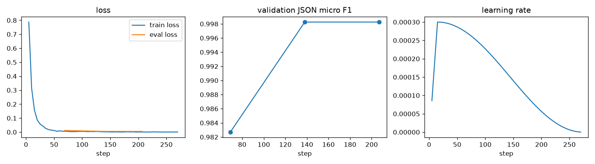

# jobpost-extractor-qlora

[](https://github.com/srini2k03/jobpost-extractor-qlora/actions/workflows/ci.yml)

Messy Indian job postings in, one strict JSON object out. A small open model (Qwen2.5-1.5B-Instruct) is
fine-tuned with QLoRA on a free Colab T4, then measured against prompting baselines, two upper bounds
(a hosted API model and an open 7B model), guided JSON decoding and a rule-based baseline. The model is quantised to GGUF for CPU serving (FastAPI,
Ollama, a Gradio Space).

> **Status.** Everything that runs on CPU is built and measured here: data generation, validation, dedup,
> the leakage-safe split, the data card, the evaluation stack, the regex baseline, the API and the demo.
> **GPU rows are pending** until the Colab notebooks are run (checklist below). No GPU number in this README
> is estimated or invented; empty cells mean "not run yet".

```text
🔥 Hiring!! Sr. Python Developer @ Kaveri Analytics Pvt Ltd
Exp: 4-7 yrs | CTC 18-24 LPA
Loc: Bangalore / Pune (Hybrid)
Must know Django, AWS, PostgreSQL, Docker
B.Tech/B.E. preferred. Call HR 9876543210. Joining kit worth ₹500!
```

Target output (what the model is trained to produce):

```json
{"company": "Kaveri Analytics", "role": "Python Developer", "seniority": "senior",
 "skills": ["python", "django", "aws", "postgresql", "docker"],
 "min_experience_years": 4, "max_experience_years": 7,
 "salary": {"min": 1800000, "max": 2400000, "currency": "INR", "period": "year"},
 "locations": ["Bengaluru", "Pune"], "work_mode": "hybrid", "employment_type": null, "education": "b.tech"}
```

Fields the posting does not state are `null` (or `[]`), never guessed; here no employment type is stated. The phone number and the ₹500 kit are
distractors. Schema: [`src/jobx/schema/models.py`](src/jobx/schema/models.py), exported as
[`schema/jobposting.schema.json`](schema/jobposting.schema.json).

## Results

All tables are generated by `jobx results-table` from the prediction files in `results/predictions/`; CI
regenerates them and fails if the committed copy is stale. Percentages, with 95% bootstrap CIs (1,000
resamples of examples).

<!-- RESULTS:START -->
#### Real postings (`test_real`, headline)

_The real test set is pending: it needs the fetch + draft-label notebook and a human pass with `jobx verify` (see the Colab checklist below)._

| Approach | Hardware | n | JSON valid % | Schema valid % | Field EM % | Micro F1 % [95% CI] | Macro F1 % | Hallucination % [95% CI] | Status |
|---|---|---|---|---|---|---|---|---|---|
| Regex baseline (rules + alias tables) | CPU | - | - | - | - | - | - | - | pending (needs this split) |
| Qwen2.5-1.5B-Instruct zero-shot | T4 | - | - | - | - | - | - | - | pending GPU run |
| Qwen2.5-1.5B-Instruct zero-shot + guided JSON | T4 | - | - | - | - | - | - | - | pending GPU run |
| Qwen2.5-1.5B-Instruct 3-shot | T4 | - | - | - | - | - | - | - | pending GPU run |
| Qwen2.5-1.5B-Instruct 3-shot + guided JSON | T4 | - | - | - | - | - | - | - | pending GPU run |
| Llama-3.2-1B-Instruct 3-shot (optional) | T4 | - | - | - | - | - | - | - | pending GPU run |
| Qwen2.5-7B-Instruct 3-shot, 4-bit (open-model upper bound) | T4 | - | - | - | - | - | - | - | pending GPU run |
| Qwen2.5-7B-Instruct 3-shot, 4-bit + guided JSON (open-model upper bound) | T4 | - | - | - | - | - | - | - | pending GPU run |
| Claude Opus 5.5 zero-shot, structured outputs (API upper bound) | Anthropic API | - | - | - | - | - | - | - | pending API run |
| Claude Opus 5.5 3-shot, structured outputs (API upper bound) | Anthropic API | - | - | - | - | - | - | - | pending API run |
| Qwen2.5-1.5B QLoRA fine-tune (ours) | T4 | - | - | - | - | - | - | - | pending GPU run |
| Qwen2.5-1.5B QLoRA fine-tune + guided JSON | T4 | - | - | - | - | - | - | - | pending GPU run |
| Llama-3.2-1B QLoRA fine-tune (optional) | T4 | - | - | - | - | - | - | - | pending GPU run |
| Fine-tune merged, bitsandbytes 8-bit | T4 | - | - | - | - | - | - | - | pending GPU run |
| Fine-tune merged, AWQ 4-bit | T4 | - | - | - | - | - | - | - | pending GPU run |
| Fine-tune merged, GGUF Q8_0 (llama.cpp) | CPU (GitHub Actions) | - | - | - | - | - | - | - | pending GPU run |
| Fine-tune merged, GGUF Q4_K_M (llama.cpp) | CPU (GitHub Actions) | - | - | - | - | - | - | - | pending GPU run |

#### Synthetic held-out families and companies (`test_synth`)

| Approach | Hardware | n | JSON valid % | Schema valid % | Field EM % | Micro F1 % [95% CI] | Macro F1 % | Hallucination % [95% CI] | Status |
|---|---|---|---|---|---|---|---|---|---|
| Regex baseline (rules + alias tables) | CPU | 471 | 100.0 | 100.0 | 91.1 | 93.1 [92.5, 93.8] | 90.8 | 2.5 [1.7, 3.2] | measured 2026-11-03 @902cc8a |
| Qwen2.5-1.5B-Instruct zero-shot | T4 | - | - | - | - | - | - | - | pending GPU run |
| Qwen2.5-1.5B-Instruct zero-shot + guided JSON | T4 | - | - | - | - | - | - | - | pending GPU run |
| Qwen2.5-1.5B-Instruct 3-shot | T4 | - | - | - | - | - | - | - | pending GPU run |
| Qwen2.5-1.5B-Instruct 3-shot + guided JSON | T4 | - | - | - | - | - | - | - | pending GPU run |
| Llama-3.2-1B-Instruct 3-shot (optional) | T4 | - | - | - | - | - | - | - | pending GPU run |
| Qwen2.5-7B-Instruct 3-shot, 4-bit (open-model upper bound) | T4 | - | - | - | - | - | - | - | pending GPU run |
| Qwen2.5-7B-Instruct 3-shot, 4-bit + guided JSON (open-model upper bound) | T4 | - | - | - | - | - | - | - | pending GPU run |
| Claude Opus 5.5 zero-shot, structured outputs (API upper bound) | Anthropic API | - | - | - | - | - | - | - | pending API run |
| Claude Opus 5.5 3-shot, structured outputs (API upper bound) | Anthropic API | - | - | - | - | - | - | - | pending API run |
| Qwen2.5-1.5B QLoRA fine-tune (ours) | T4 | - | - | - | - | - | - | - | pending GPU run |
| Qwen2.5-1.5B QLoRA fine-tune + guided JSON | T4 | - | - | - | - | - | - | - | pending GPU run |
| Llama-3.2-1B QLoRA fine-tune (optional) | T4 | - | - | - | - | - | - | - | pending GPU run |
| Fine-tune merged, bitsandbytes 8-bit | T4 | - | - | - | - | - | - | - | pending GPU run |
| Fine-tune merged, AWQ 4-bit | T4 | - | - | - | - | - | - | - | pending GPU run |
| Fine-tune merged, GGUF Q8_0 (llama.cpp) | CPU (GitHub Actions) | - | - | - | - | - | - | - | pending GPU run |
| Fine-tune merged, GGUF Q4_K_M (llama.cpp) | CPU (GitHub Actions) | - | - | - | - | - | - | - | pending GPU run |

#### Per-field exact match % (`test_synth`)

| Approach | company | role | seniority | skills | min_experience_years | max_experience_years | salary | locations | work_mode | employment_type | education |
|---|---|---|---|---|---|---|---|---|---|---|---|
| Regex baseline (rules + alias tables) | 48.2 | 75.4 | 79.2 | 99.4 | 100.0 | 100.0 | 100.0 | 100.0 | 100.0 | 100.0 | 100.0 |

#### Size / speed / accuracy trade-off

| Variant | Hardware | Size (GB) | Micro F1 % | Tokens/s | Peak memory (GB) | Status |
|---|---|---|---|---|---|---|
| fp16 (transformers) | T4 | - | - | - | - | pending GPU run |
| merged 8-bit (bitsandbytes) | T4 | - | - | - | - | pending GPU run |
| AWQ 4-bit | T4 | - | - | - | - | pending GPU run |
| GGUF Q8_0 (llama.cpp) | CPU, GitHub Actions | - | - | - | - | pending (needs merged model) |
| GGUF Q4_K_M (llama.cpp) | CPU, GitHub Actions | - | - | - | - | pending (needs merged model) |
<!-- RESULTS:END -->

**About the regex baseline.** It is a real CPU run, but read it as a sanity check of the evaluation stack
rather than a competitor. Its patterns were written with all synthetic templates in view (including the
held-out families), and it shares alias tables and salary/experience parsers with the generator. So
`test_synth` flatters it. Company and role, the fields its patterns can't pin down, are where it fails
(see `notebooks/06_error_analysis.ipynb`). The real-postings split is the honest comparison.

### Training curves

_Pending GPU run._ `notebooks/03_train_qlora.ipynb` exports the Trainer log history and
`results/training/curves.png` (train/validation loss, validation JSON micro F1, learning rate), and the W&B
run holds the same curves plus sample generations per evaluation. After the run, `jobx pull` brings them into
this repo and the image appears here:



## How it works

**Data** ([`DATA_CARD.md`](DATA_CARD.md), generated from real statistics of the committed set)
1. *Synthetic, labels by construction.* A structured record is sampled first from Indian job-market
   vocabularies: 18 role domains, 143 skills with aliases, 35 cities with aliases, salary bands by
   seniority in LPA or per month, experience ranges and fictional company names. The record is then
   rendered through alias tables, 12 template families (Naukri-style, LinkedIn prose, WhatsApp forward,
   consultancy mail, walk-in drive, Telegram channel, Hinglish chat...) and noise operators: typos,
   abbreviations, emojis, bullets, shuffled sections, HTML remnants, Hinglish fragments and distractors such as
   phone numbers, "₹500 joining kit", referral bonuses, notice periods, "in business for 15 years" and a
   "headquartered in <other city>" trap.
2. *Recoverability checker* (`src/jobx/data/validate.py`): every gold value must be findable in the text
   with the same parsers the evaluator uses. Paraphrases must also introduce nothing new. An optional NLI
   hook adds an entailment check per field. On the current set it rejects 0 of 3,000 generated postings,
   after it caught a real template bug during development.
3. *LLM paraphrase pass* (Qwen2.5-7B 4-bit, notebook 01), filtered by the checker. The filter rate goes into
   the data card. Pending GPU run.
4. *MinHash near-duplicate removal* (word 3-gram shingles, 128 permutations, LSH 32×4, exact-Jaccard
   confirmation). It keeps the test copy when a train item collides with it.
5. *Leakage-safe split*: template families **and** companies are disjoint across train / val / test_synth.
   This is verified in the build and in the tests.
6. *Real postings* (~200, from a permissively licensed HF dataset) drafted by the 7B model and checked by a
   human with `jobx verify`. This **real-only test split is the headline evaluation**. Pending; see
   [`docs/real_dataset.md`](docs/real_dataset.md).

**Baselines** (notebook 02): Qwen2.5-1.5B zero-shot and 3-shot and an optional Llama-3.2-1B. Each runs
with free decoding and with guided JSON decoding (lm-format-enforcer).

**Upper bounds.** There are two:
- **Hosted API model:** Claude Opus 5.5, zero-shot and 3-shot
  ([`anthropic_runner.py`](src/jobx/baselines/anthropic_runner.py), run by
  [`api_baseline.yml`](.github/workflows/api_baseline.yml)). It uses structured outputs (the `JobPosting`
  JSON Schema in `output_config.format`) at effort `low`, with server-side refusal fallbacks on. Rows show
  "pending API run" until the workflow has run.
  - The runner prices the run with `count_tokens` before sending anything.
  - It shrinks the evenly spaced test subset to fit a $2 budget, and stops starting requests if actual
    spend would pass it.
  - It records tokens and cost per posting.
- **Open 7B model:** Qwen2.5-7B-Instruct 3-shot in 4-bit on the T4 (free and guided decoding). It is the
  model you could run yourself.

All approaches use the same system prompt and schema as the fine-tune
([`src/jobx/prompts.py`](src/jobx/prompts.py)).

**Fine-tuning** (notebook 03, [`src/jobx/train/sft.py`](src/jobx/train/sft.py)): the recipe is QLoRA
(4-bit NF4 with double quantisation, fp16 compute because the T4 has no bf16) with TRL `SFTTrainer`.
The loss covers completion tokens only, and LoRA r=16/α=32 is applied to all linear projections, with
gradient checkpointing and paged 8-bit AdamW. The learning rate is 2e-4 with a cosine schedule and 3%
warmup, and the effective batch is 16. Early stopping uses validation JSON micro F1, computed by greedy
decoding at each evaluation. Weights & Biases logging is on. The choices are explained in
[`docs/hyperparameters.md`](docs/hyperparameters.md), and a small r/lr sweep is included.

**Evaluation** ([`src/jobx/eval`](src/jobx/eval), CPU only, runs in CI on saved predictions)
- JSON validity (a parseable object), schema validity (validates against `JobPosting` exactly).
- Per-field exact match after normalisation: salary is compared as INR per annum (12 months, 2,080
  hours, 83 INR/USD) and rounded to ₹1,000, so "1.5L/month" equals "18 LPA". Skills and cities are
  canonicalised through alias tables. Company names drop legal suffixes, and roles drop seniority words.
- Precision/recall/F1 for scalar fields (a stated prediction is a TP if correct, else an FP; a stated gold
  value missed or wrong is an FN). For list fields (skills, locations) they are computed element-wise.
  Micro F1 pools all fields; macro F1 averages per-field F1.
- **Hallucination rate**: fields that are null in gold but filled in the prediction, divided by all gold-null
  fields.
- Bootstrap 95% CIs, and an automatic error taxonomy (`src/jobx/eval/taxonomy.py`): invalid JSON,
  truncation, schema-invalid, wrong salary unit, missed/spurious skill, hallucinated field, location
  confusion, seniority mismatch, experience/role/company errors.

**Optimisation**: the merged model is converted to GGUF Q8_0 and Q4_K_M, with llama.cpp built inside
GitHub Actions ([`quantize_benchmark.yml`](.github/workflows/quantize_benchmark.yml)), and benchmarked on the
runner's CPU: tokens/s, peak RAM and accuracy. AWQ 4-bit and bitsandbytes 8-bit are benchmarked on the
T4 (notebook 05).

**Serving**
- FastAPI `POST /extract` ([`src/jobx/serve/app.py`](src/jobx/serve/app.py)) uses llama-cpp-python (GGUF,
  CPU), validates against the schema and re-prompts on invalid output. It also offers optional
  grammar-guided decoding. Dockerfile in [`docker/`](docker/Dockerfile).
- Ollama: [`ollama/Modelfile`](ollama/Modelfile), generated from the same prompt.
- Gradio Space ([`space/`](space/)) with examples, a JSON view and field highlighting. It is deployed from
  Actions with an `HF_TOKEN` secret.
- Model cards for the adapter, merged, GGUF and AWQ repos: [`model_cards/`](model_cards/).

## Run it

CPU (everything in this README that is not a GPU row):

```bash
pip install -e ".[dev,serve]"
jobx build-data          # 3,000 synthetic postings -> validate -> split -> dedup -> DATA_CARD.md
jobx regex-baseline      # predictions for the regex baseline
jobx eval                # metrics + bootstrap CIs for every predictions file
jobx results-table       # tables above + results/results.json
jobx taxonomy            # error taxonomy counts
pytest && ruff check . && mypy
JOBX_BACKEND=regex uvicorn jobx.serve.app:app   # API without a model (rule-based backend)
```

### Colab checklist (GPU work, in order)

Secrets in Colab (key icon, with *Notebook access* on): `HF_TOKEN` (write), `HF_USERNAME`, `WANDB_API_KEY`.
Each notebook opens with an *Open in Colab* badge and run-all instructions, and pushes its outputs to repos
under your Hugging Face account (the `jobx-artifacts` dataset repo is private). Afterwards, `jobx pull` downloads them into this repo, and
`jobx eval && jobx results-table` updates the tables.

| # | Notebook | Runtime | Secrets | Produces |
|---|---|---|---|---|
| 1 | `01_paraphrase_7b` | T4, ~1.5 h | HF_TOKEN, HF_USERNAME | validated paraphrases + filter stats; real-postings drafts |
| - | `jobx pull && jobx verify` (your machine) | ~30 min | HF_TOKEN | `data/real/test_real.jsonl` (human-verified) |
| 2 | `02_baselines` | T4, ~2–2.5 h (can be split) | HF_TOKEN, HF_USERNAME | zero/few-shot (+guided) predictions and metrics, 1.5B and 7B |
| 3 | `03_train_qlora` | T4, ~1–1.5 h | HF_TOKEN, HF_USERNAME, WANDB_API_KEY | LoRA adapter on the Hub, W&B run, log history + curves |
| 4 | `04_eval_predict` | T4, ~45–60 min | HF_TOKEN, HF_USERNAME | fine-tune predictions (+guided), merged fp16 model on the Hub |
| 5 | Actions → `quantize-benchmark` | CPU runner, ~1–2 h | repo secret HF_TOKEN, variable HF_USERNAME | GGUF Q8_0/Q4_K_M on the Hub, CPU benchmark + predictions committed |
| 6 | `05_awq_benchmark` | T4, ~45 min | HF_TOKEN, HF_USERNAME | AWQ model, T4 benchmark rows (fp16 / 8-bit / AWQ) |
| 7 | `06_error_analysis` | CPU, ~1 min | (HF_TOKEN to pull) | taxonomy table, chart, worked examples |
| 8 | Actions → `deploy-space` | ~5 min | HF_TOKEN | Gradio Space running the Q4 GGUF |
| 9 | Actions → `api-baseline` (any time; rerun after `test_real` lands) | ~10 min, ≤ $2 | repo secret ANTHROPIC_API_KEY | Claude Opus 5.5 zero/3-shot predictions, metrics and table, committed |

## Repository layout

```text
src/jobx/
  schema/        Pydantic schema, JSON Schema export, output parser
  vocab.py       skills / cities / degrees / enums with aliases, salary bands (shared by generator and evaluator)
  normalize/     salary -> INR p.a., experience parser, skill/city canonicalisation, field normalisers
  data/          generate, surface forms, templates, noise, validate, paraphrase, dedup, split, build, datacard, fetch_real
  baselines/     regex extractor, HF runner (free + guided decoding), notebook orchestration
  train/         sft.py (TRL SFTTrainer, QLoRA), merge.py, config loading
  eval/          metrics, bootstrap, taxonomy, results tables, curves, Pages site
  quantize/      GGUF CPU benchmark (llama-server), T4/AWQ benchmark helpers
  serve/         FastAPI app, extractor with retries, LLM backends, highlighting
  verify.py      human verification CLI for the real test set
configs/         data, approaches, hub, real data, training (+ sweep)
notebooks/       01-06, Colab-ready (generated by scripts/build_notebooks.py)
space/           Gradio app for Hugging Face Spaces
docker/ ollama/ model_cards/ docs/ results/ data/ tests/ .github/workflows/
```

## Limitations

- **Synthetic-heavy training data.** Templates and noise cannot cover real-world variety. That is why
  the headline split is real postings, and why that split is pending until a human has verified it.
- **Short texts.** Synthetic postings are shorter than many real job descriptions (median ~0.4k characters;
  see the data card). Long JDs with heavy boilerplate are under-represented.
- **Closed vocabularies.** Skills and cities are canonicalised through fixed alias tables. A skill outside
  the table can only match exactly (lower-cased).
- **Conventions are opinions.** Seniority is labelled only when stated in words. Role excludes seniority
  words. Skills named in the title count as skills. Salary conversion uses fixed constants. A model that
  follows different but reasonable conventions is penalised.
- **The regex baseline is optimistic on synthetic data** (see above).
- **The API upper bound runs on a budget.** To stay under ~$2 per run, it uses effort `low` and an evenly
  spaced subset (its `n` is in the table). So its CIs are wider than those of rows that score the full split.
- **Free-tier serving.** The Space and CPU benchmarks run on shared CPUs, so latency varies between runs.
- **Licence of real postings** is a TODO until a human confirms the source dataset's terms.

## Licence

Code and synthetic data: MIT. Base models and real-postings data keep their own licences (Qwen2.5:
Apache-2.0; Llama 3.2: Llama 3.2 Community License).
