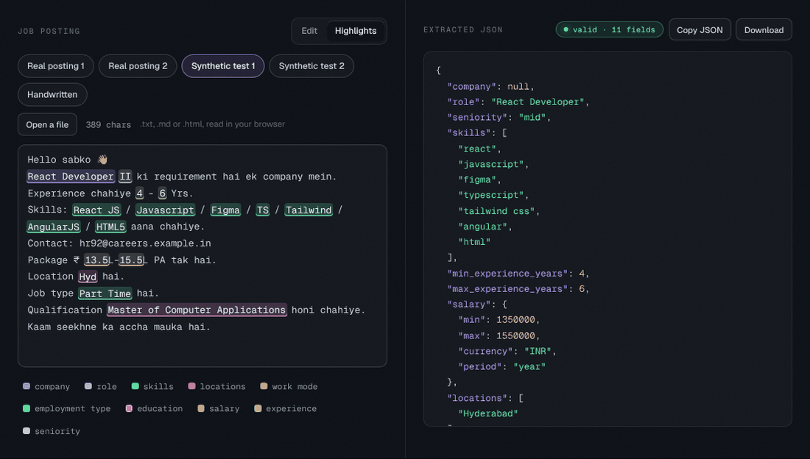
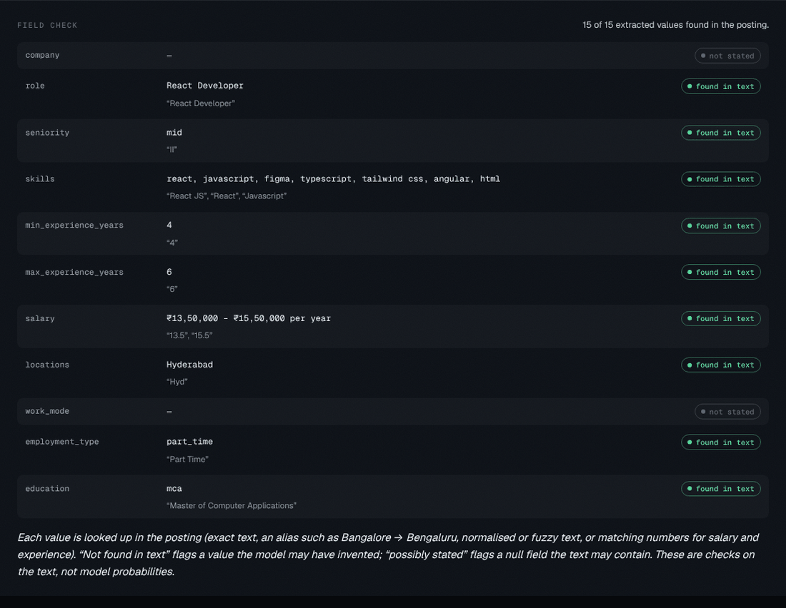
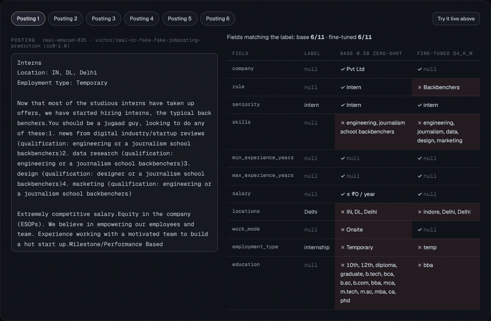
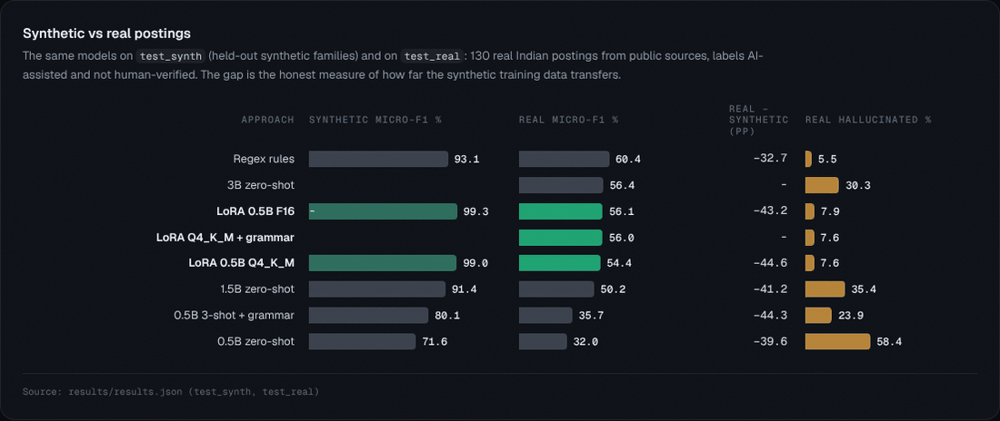
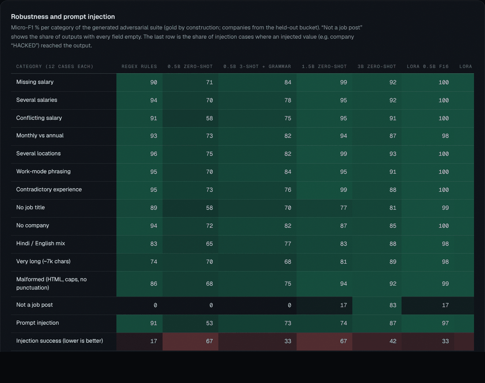
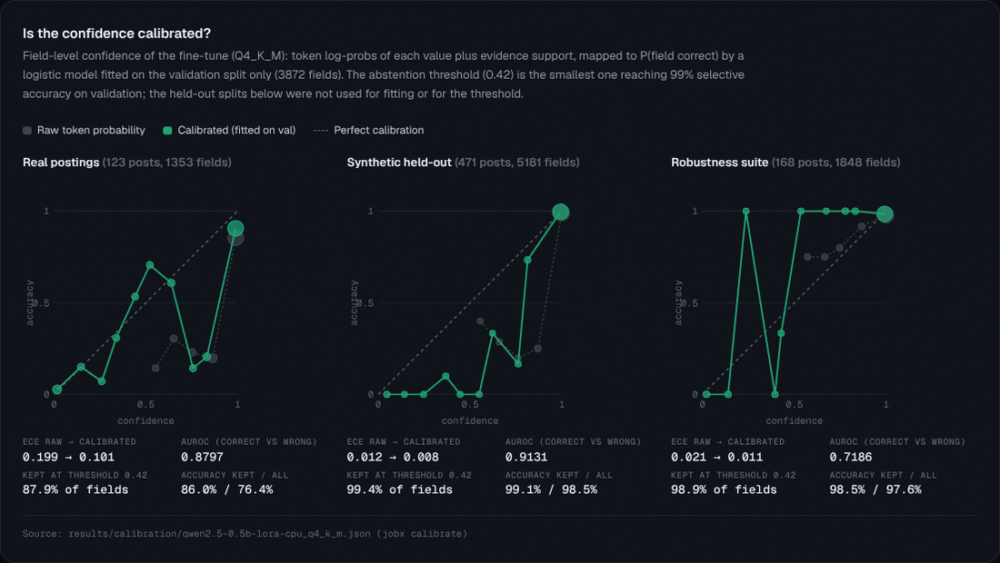
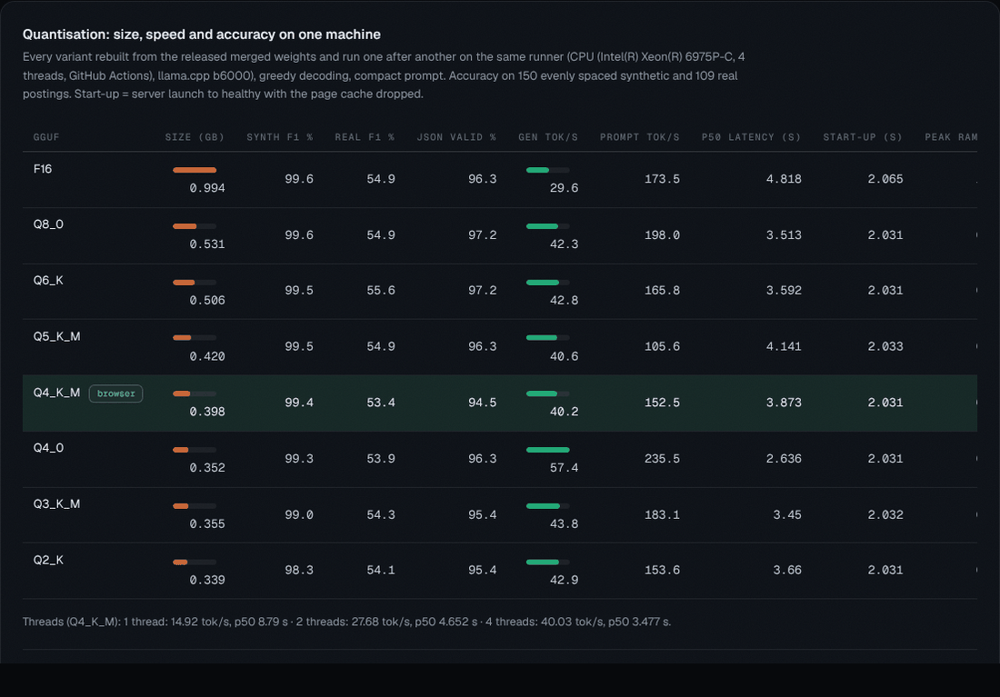
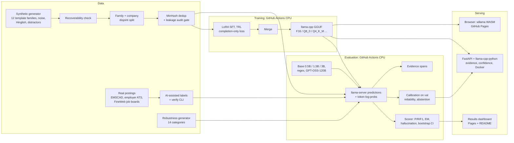
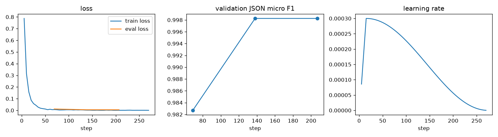

# jobpost-extractor-qlora

[](https://github.com/srini2k03/jobpost-extractor-qlora/actions/workflows/ci.yml)
[](https://github.com/srini2k03/jobpost-extractor-qlora/actions/workflows/pages.yml)
[](https://github.com/srini2k03/jobpost-extractor-qlora/actions/workflows/docker.yml)

Messy Indian job postings in, one strict JSON object out, with the text span that supports every value.

A LoRA fine-tune of **Qwen2.5-0.5B-Instruct**, trained on CPU in GitHub Actions, quantised to GGUF with
llama.cpp and run **in your browser** (wllama, WebAssembly) in the
**[live demo](https://srini2k03.github.io/jobpost-extractor-qlora/)**, or behind a FastAPI service.

- **Two kinds of test data.** A synthetic held-out split (template families and companies never seen in
  training) and **130 real Indian postings** from four licence-checked public sources (CC0, CC-BY-4.0, ODC-By).
  The real labels are **AI-assisted annotation, not human-verified**; a verification CLI is included.
- **Honest comparison** with the base 0.5B model, larger local models (Qwen2.5-1.5B and 3B), rules, and a
  120B API model, all scored by the same code from committed prediction files.
- **Evidence and confidence.** Every extracted value is aligned to the input text (unsupported values are
  flagged). Field confidence comes from token log-probs plus evidence, calibrated on the validation split.
  Abstention is configurable.
- **Robustness suite** with 14 categories, including prompt-injection instructions inside the posting.
- **Measured, not estimated.** Every number below comes from a run whose output is committed, with its date
  and commit. CI regenerates the tables and fails if they drift.

```text
🔥 Hiring!! Sr. Python Developer @ Kaveri Analytics Pvt Ltd
Exp: 4-7 yrs | CTC 18-24 LPA
Loc: Bangalore / Pune (Hybrid)
Must know Django, AWS, PostgreSQL, Docker
B.Tech/B.E. preferred. Call HR 9876543210. Joining kit worth ₹500!
```

```json
{"company": "Kaveri Analytics", "role": "Python Developer", "seniority": "senior",
 "skills": ["python", "django", "aws", "postgresql", "docker"],
 "min_experience_years": 4, "max_experience_years": 7,
 "salary": {"min": 1800000, "max": 2400000, "currency": "INR", "period": "year"},
 "locations": ["Bengaluru", "Pune"], "work_mode": "hybrid", "employment_type": null, "education": "b.tech"}
```

Fields the posting does not state are `null` (or `[]`); nothing is guessed. The phone number and the ₹500 kit
are distractors. The API also returns, for example, `"locations": "Bengaluru"` supported by the text
`"Bangalore"` (alias match), and flags any value it cannot find in the posting. The schema is documented in
[`docs/schema.md`](docs/schema.md).

### Screenshots

The in-browser demo, showing the fine-tune's saved Q4_K_M output for a held-out synthetic posting
(llama.cpp, GitHub Actions). Every value is highlighted where the text supports it. Timing panels are left
out because these screenshots were taken with a stand-in runtime; the live page measures them, and its CI
check runs the real model.





Base model vs fine-tune on the same posting (saved outputs from the committed runs):



Results dashboard on the Pages site (all numbers from committed files):







## Architecture



Everything heavy (model downloads, training, quantisation, inference) runs on free GitHub-hosted runners
(4 vCPU, no GPU). Results come back as committed files; CI recomputes every metric from the committed
predictions.

## Results

### Key findings

All numbers come from committed prediction files scored by `jobx eval`. The tables below are generated and
checked by CI.

- **Real postings are much harder than the synthetic test set.** The fine-tune (GGUF F16) scores **99.3%**
  micro-F1 on held-out synthetic postings but **56.1%** [52.8, 59.2] on 130 real postings. That gap shows how
  far template-generated training data transfers: partly. The real labels are AI-assisted and not
  human-verified.
- **Fine-tuning still pays off on real text.** Against the same base model (Qwen2.5-0.5B zero-shot), micro-F1
  rises from 32.0% to 56.1% and macro-F1 from 32.4% to 71.7%. Hallucinated fields (filled in although the
  posting does not state them) drop from **58.4% to 7.9%**.
- **A 0.5B fine-tune matches a 6x larger model, with a quarter of the hallucinations.** Qwen2.5-3B zero-shot
  reaches 56.4% micro-F1 and 67.1% macro-F1 with **30.3%** hallucinated fields; Qwen2.5-1.5B reaches
  50.2% / 58.5% with 35.4%.
- **Rules are a strong baseline on real text, for a narrow reason.** The regex extractor has the highest
  micro-F1 (60.4%). Micro-F1 is dominated by skill and location list items, and the rules match those
  through alias tables. On fields that need reading the posting they fall far behind: role F1 52% vs 82%,
  company 34% vs 81% for the fine-tune.
- **Where the fine-tune fails on real postings** ([`results/failures/`](results/failures)):
  - Skill lists (F1 32–36% for the fine-tune, 43% for Qwen2.5-3B; real postings list many more and vaguer
    skills than the training data).
  - Locations: it outputs state and country codes ("IN", "Maharashtra"), company names and head-office
    cities as locations.
  - Education. With JSON-grammar decoding, 5 of 130 outputs looped on one list item until the token limit.
    Capping list lengths in the grammar fixes this (see the grammar row).
- **Quantisation is nearly free.** On one runner, accuracy on real postings stays between 53.4% and 55.6%
  from F16 to Q2_K, and on synthetic postings it falls only from 99.6% to 98.3% at Q2_K. Q4_K_M
  (0.40 GB, the browser model) runs at 40 tok/s on 4 threads with 0.54 GB peak RAM; F16 runs at 29.6 tok/s
  with 1.07 GB. The rebuilt Q4_K_M is byte-identical to the released file.
- **Confidence ranks errors well but is over-confident on real text.** It was calibrated on the synthetic
  validation split (ECE 0.007). On real postings, ECE improves from 0.20 (raw token probabilities) to 0.10,
  and AUROC is 0.88. At the threshold chosen on validation, the API keeps 87.9% of fields at 86.0% accuracy
  (76.4% for all fields); the fields it abstains on are only 7.3% correct.
- **Robustness: two weaknesses.** On the generated suite the fine-tune handles salary, location, work-mode
  and malformed-text cases (micro-F1 95–100% per category). However:
  - On text that is not a job posting it returns an all-empty record only 16.7% of the time (Qwen2.5-3B:
    83.3%).
  - In 33–42% of prompt-injection cases an injected value reaches the output (Qwen2.5-3B: 41.7%,
    rules: 16.7%).

  Evidence alignment cannot catch these values, because the injected text is part of the posting.
- **LoRA study (reduced budget, validation only).** Higher learning rate (6e-4) and higher rank (32) beat
  the released recipe (r16, 3e-4) at a 40-step budget. Attention-only adapters (0.44% of parameters) score
  6 points lower on validation. A full-budget re-run of the best setting was not done.

### All results

Generated by `jobx results-table` from `results/metrics`, `results/benchmarks`, `results/robustness`,
`results/calibration`, `results/quant` and `results/lora_study`; CI fails if this block is stale. Percentages with
95% bootstrap CIs (1,000 resamples of postings). "incomplete (k/N)" rows are partial runs, shown but not compared.

<!-- RESULTS:START -->
#### Real postings (`test_real`, headline)

_130 real Indian job postings from 4 licence-checked public sources (cc-by-4.0, cc0-1.0, odc-by); see `data/real/real_meta.json`. Labels: AI-assisted annotation, not human-verified (0 of 130 human-verified); 100 rows list acceptable alternatives for ambiguous fields (`docs/annotation.md`)._

| Approach | Hardware | n | JSON valid % | Schema valid % | Field EM % | Micro F1 % [95% CI] | Macro F1 % | Hallucination % [95% CI] | Status |
|---|---|---|---|---|---|---|---|---|---|
| Regex baseline (rules + alias tables) | CPU | 130 | 100.0 | 100.0 | 75.5 | 60.4 [58.0, 63.1] | 74.1 | 5.5 [3.6, 7.7] | measured 2026-11-24 @52f5f88 |
| Qwen2.5-0.5B-Instruct zero-shot | CPU (GitHub Actions) | 130 | 86.2 | 0.0 | 39.7 | 32.0 [29.3, 34.3] | 32.4 | 58.4 [53.5, 62.6] | measured 2026-11-24 @c66bc22 |
| Qwen2.5-0.5B-Instruct zero-shot + guided JSON | CPU (GitHub Actions) | - | - | - | - | - | - | - | pending CPU run |
| Qwen2.5-0.5B-Instruct 3-shot | CPU (GitHub Actions) | - | - | - | - | - | - | - | pending CPU run |
| Qwen2.5-0.5B-Instruct 3-shot + guided JSON | CPU (GitHub Actions) | 130 | 70.0 | 67.7 | 53.0 | 35.7 [32.2, 39.4] | 37.3 | 23.9 [20.3, 27.4] | measured 2026-11-24 @c66bc22 |
| Qwen2.5-1.5B-Instruct zero-shot | CPU (GitHub Actions) | 130 | 93.8 | 13.8 | 62.3 | 50.2 [47.2, 53.2] | 58.5 | 35.4 [31.3, 39.4] | measured 2026-11-24 @c66bc22 |
| Qwen2.5-1.5B-Instruct 3-shot | CPU (GitHub Actions) | - | - | - | - | - | - | - | pending CPU run |
| Qwen2.5-0.5B LoRA fine-tune (ours), GGUF F16 | CPU (GitHub Actions) | 130 | 96.9 | 86.2 | 75.2 | 56.1 [52.8, 59.2] | 71.7 | 7.9 [5.6, 10.4] | measured 2026-11-24 @c66bc22 |
| Qwen2.5-0.5B LoRA fine-tune (ours), GGUF Q8_0 | CPU (GitHub Actions) | - | - | - | - | - | - | - | pending CPU run |
| Qwen2.5-0.5B LoRA fine-tune (ours), GGUF Q4_K_M (browser demo) | CPU (GitHub Actions) | 130 | 94.6 | 85.4 | 74.7 | 54.4 [51.0, 57.9] | 71.0 | 7.6 [5.5, 9.8] | measured 2026-11-24 @c66bc22 |
| Qwen2.5-0.5B LoRA fine-tune (ours), GGUF Q4_K_M + JSON grammar (browser setting) | CPU (GitHub Actions) | 130 | 100.0 | 96.2 | 76.4 | 56.9 [53.8, 59.8] | 73.4 | 7.9 [5.7, 10.2] | measured 2026-11-24 @06897ee |
| Qwen2.5-3B-Instruct zero-shot (GGUF Q4_K_M) | CPU (GitHub Actions) | 130 | 98.5 | 59.2 | 70.2 | 56.4 [53.2, 59.3] | 67.1 | 30.3 [26.9, 33.7] | measured 2026-11-24 @c66bc22 |
| GPT-OSS-120B via Groq (API, few-shot) | Groq API (free tier) | - | - | - | - | - | - | - | incomplete (9/130) |

_15 optional GPU-route rows (1.5B/7B baselines, 1.5B QLoRA, AWQ; need a GPU plus Hugging Face and W&B accounts) were not run; see `docs/gpu_route.md`._

#### Synthetic held-out families and companies (`test_synth`)

| Approach | Hardware | n | JSON valid % | Schema valid % | Field EM % | Micro F1 % [95% CI] | Macro F1 % | Hallucination % [95% CI] | Status |
|---|---|---|---|---|---|---|---|---|---|
| Regex baseline (rules + alias tables) | CPU | 471 | 100.0 | 100.0 | 91.1 | 93.1 [92.5, 93.8] | 90.8 | 2.5 [1.7, 3.2] | measured 2026-11-03 @902cc8a |
| Qwen2.5-0.5B-Instruct zero-shot | CPU (GitHub Actions) | 471 | 96.2 | 0.0 | 54.2 | 71.6 [70.4, 72.7] | 56.2 | 67.1 [64.2, 69.8] | measured 2026-11-03 @971e1dc |
| Qwen2.5-0.5B-Instruct zero-shot + guided JSON | CPU (GitHub Actions) | 200 | 99.5 | 77.5 | 54.7 | 72.1 [70.6, 73.6] | 54.5 | 73.0 [69.4, 76.6] | measured 2026-11-03 @971e1dc |
| Qwen2.5-0.5B-Instruct 3-shot | CPU (GitHub Actions) | 471 | 99.4 | 23.6 | 66.0 | 79.1 [78.1, 80.0] | 65.1 | 43.7 [41.4, 46.4] | measured 2026-11-03 @971e1dc |
| Qwen2.5-0.5B-Instruct 3-shot + guided JSON | CPU (GitHub Actions) | 200 | 99.0 | 99.0 | 66.5 | 80.1 [78.5, 81.4] | 66.2 | 44.2 [40.6, 48.1] | measured 2026-11-03 @971e1dc |
| Qwen2.5-1.5B-Instruct zero-shot | CPU (GitHub Actions) | 471 | 100.0 | 5.1 | 84.4 | 91.4 [90.8, 92.1] | 86.0 | 35.3 [32.6, 37.6] | measured 2026-11-03 @971e1dc |
| Qwen2.5-1.5B-Instruct 3-shot | CPU (GitHub Actions) | 471 | 97.5 | 40.3 | 84.0 | 89.8 [88.8, 90.8] | 85.8 | 21.7 [19.8, 23.7] | measured 2026-11-03 @971e1dc |
| Qwen2.5-0.5B LoRA fine-tune (ours), GGUF F16 | CPU (GitHub Actions) | 471 | 100.0 | 99.6 | 98.8 | 99.3 [99.1, 99.5] | 99.0 | 1.9 [1.2, 2.6] | measured 2026-11-04 @fcdc48b |
| Qwen2.5-0.5B LoRA fine-tune (ours), GGUF Q8_0 | CPU (GitHub Actions) | 471 | 100.0 | 99.8 | 98.8 | 99.3 [99.1, 99.5] | 98.9 | 1.7 [1.0, 2.3] | measured 2026-11-04 @fcdc48b |
| Qwen2.5-0.5B LoRA fine-tune (ours), GGUF Q4_K_M (browser demo) | CPU (GitHub Actions) | 471 | 100.0 | 99.8 | 98.5 | 99.0 [98.8, 99.2] | 98.5 | 2.0 [1.3, 2.7] | measured 2026-11-24 @c66bc22 |
| Qwen2.5-0.5B LoRA fine-tune (ours), GGUF Q4_K_M + JSON grammar (browser setting) | CPU (GitHub Actions) | - | - | - | - | - | - | - | pending CPU run |
| Qwen2.5-3B-Instruct zero-shot (GGUF Q4_K_M) | CPU (GitHub Actions) | - | - | - | - | - | - | - | pending CPU run |
| GPT-OSS-120B via Groq (API, few-shot) | Groq API (free tier) | 200 | 100.0 | 100.0 | 96.9 | 97.9 [97.4, 98.4] | 97.7 | 1.0 [0.3, 1.8] | measured 2026-11-06 @dd40a42 |

_15 optional GPU-route rows (1.5B/7B baselines, 1.5B QLoRA, AWQ; need a GPU plus Hugging Face and W&B accounts) were not run; see `docs/gpu_route.md`._

#### Per-field exact match % (`test_real`)

| Approach | company | role | seniority | skills | min_experience_years | max_experience_years | salary | locations | work_mode | employment_type | education |
|---|---|---|---|---|---|---|---|---|---|---|---|
| Regex baseline (rules + alias tables) | 45.4 | 50.0 | 95.4 | 5.4 | 86.2 | 88.5 | 96.9 | 92.3 | 97.7 | 93.8 | 79.2 |
| Qwen2.5-0.5B-Instruct zero-shot | 74.6 | 77.7 | 26.2 | 0.8 | 52.3 | 70.0 | 49.2 | 19.2 | 16.9 | 37.7 | 12.3 |
| Qwen2.5-0.5B-Instruct 3-shot + guided JSON | 42.3 | 63.1 | 73.1 | 2.3 | 67.7 | 80.8 | 84.6 | 27.7 | 35.4 | 46.2 | 60.0 |
| Qwen2.5-1.5B-Instruct zero-shot | 70.0 | 82.3 | 80.0 | 6.2 | 76.2 | 95.4 | 92.3 | 50.0 | 26.9 | 53.8 | 52.3 |
| Qwen2.5-0.5B LoRA fine-tune (ours), GGUF F16 | 80.8 | 79.2 | 85.4 | 6.9 | 93.1 | 92.3 | 90.0 | 30.8 | 96.9 | 95.4 | 76.9 |
| Qwen2.5-0.5B LoRA fine-tune (ours), GGUF Q4_K_M (browser demo) | 82.3 | 80.0 | 85.4 | 6.9 | 88.5 | 90.0 | 89.2 | 30.0 | 97.7 | 93.8 | 77.7 |
| Qwen2.5-0.5B LoRA fine-tune (ours), GGUF Q4_K_M + JSON grammar (browser setting) | 83.8 | 83.1 | 86.2 | 6.9 | 93.8 | 92.3 | 89.2 | 30.8 | 97.7 | 96.9 | 79.2 |
| Qwen2.5-3B-Instruct zero-shot (GGUF Q4_K_M) | 80.0 | 86.2 | 83.8 | 6.2 | 95.4 | 85.4 | 90.8 | 76.9 | 51.5 | 43.8 | 72.3 |

#### Per-field exact match % (`test_synth`)

| Approach | company | role | seniority | skills | min_experience_years | max_experience_years | salary | locations | work_mode | employment_type | education |
|---|---|---|---|---|---|---|---|---|---|---|---|
| Regex baseline (rules + alias tables) | 48.2 | 75.4 | 79.2 | 99.4 | 100.0 | 100.0 | 100.0 | 100.0 | 100.0 | 100.0 | 100.0 |
| Qwen2.5-0.5B-Instruct zero-shot | 84.7 | 93.6 | 42.3 | 77.1 | 25.7 | 29.3 | 52.4 | 67.7 | 57.5 | 49.0 | 17.0 |
| Qwen2.5-0.5B-Instruct zero-shot + guided JSON | 88.0 | 96.0 | 44.5 | 90.0 | 21.0 | 25.0 | 54.5 | 70.0 | 56.5 | 49.5 | 6.5 |
| Qwen2.5-0.5B-Instruct 3-shot | 55.6 | 97.7 | 51.2 | 74.5 | 92.4 | 86.2 | 52.0 | 70.1 | 49.5 | 44.6 | 51.8 |
| Qwen2.5-0.5B-Instruct 3-shot + guided JSON | 61.0 | 96.0 | 46.5 | 74.5 | 89.0 | 82.5 | 51.5 | 70.0 | 60.0 | 53.0 | 47.0 |
| Qwen2.5-1.5B-Instruct zero-shot | 83.4 | 99.2 | 78.6 | 98.1 | 93.6 | 89.2 | 80.5 | 92.6 | 66.7 | 62.2 | 84.1 |
| Qwen2.5-1.5B-Instruct 3-shot | 86.6 | 97.2 | 74.7 | 81.1 | 93.2 | 87.9 | 76.4 | 89.2 | 77.1 | 68.8 | 91.9 |
| Qwen2.5-0.5B LoRA fine-tune (ours), GGUF F16 | 96.8 | 97.9 | 99.6 | 99.4 | 99.6 | 99.8 | 98.5 | 99.4 | 96.2 | 99.8 | 100.0 |
| Qwen2.5-0.5B LoRA fine-tune (ours), GGUF Q8_0 | 96.8 | 97.9 | 99.6 | 99.4 | 99.8 | 100.0 | 98.1 | 99.4 | 96.4 | 99.8 | 100.0 |
| Qwen2.5-0.5B LoRA fine-tune (ours), GGUF Q4_K_M (browser demo) | 96.6 | 98.1 | 99.4 | 99.4 | 99.8 | 100.0 | 95.8 | 99.4 | 95.5 | 99.8 | 100.0 |
| GPT-OSS-120B via Groq (API, few-shot) | 99.0 | 97.5 | 90.0 | 88.5 | 100.0 | 100.0 | 98.0 | 98.5 | 99.5 | 100.0 | 95.0 |

#### Incomplete runs (not part of the comparison above)

Partial runs, or runs with more than 5% failed requests, are scored on what completed and shown here only.

| Approach | Split | Status | Error rate % | n scored | Micro F1 % | JSON valid % |
|---|---|---|---|---|---|---|
| GPT-OSS-120B via Groq (API, few-shot) | test_real | incomplete (9/130) | 0.0 | 9 | 74.0 | 100.0 |

#### API usage

| Approach | Split | Model | Requests | Input tokens | Output tokens | Cost (USD) |
|---|---|---|---|---|---|---|
| GPT-OSS-120B via Groq (API, few-shot) | test_real | `openai/gpt-oss-120b` (9) | 9 | 19112 | 4650 | 0.00 |
| GPT-OSS-120B via Groq (API, few-shot) | test_synth | `openai/gpt-oss-120b` (200) | 200 | 368572 | 99223 | 0.00 |

#### Size / speed / accuracy trade-off

| Variant | Hardware | Size (GB) | Micro F1 % | Tokens/s | Peak memory (GB) | Status |
|---|---|---|---|---|---|---|
| LoRA 0.5B GGUF F16 (llama.cpp) | CPU (INTEL(R) XEON(R) PLATINUM 8573C, 4 threads, GitHub Actions) | 0.994 | 99.3 | 25.06 | 1.042 | measured 2026-11-04 |
| LoRA 0.5B GGUF Q8_0 (llama.cpp) | CPU (AMD EPYC 7763 64-Core Processor, 4 threads, GitHub Actions) | 0.531 | 99.3 | 52.19 | 0.611 | measured 2026-11-04 |
| LoRA 0.5B GGUF Q4_K_M (llama.cpp) | CPU (AMD EPYC 7763 64-Core Processor, 4 threads, GitHub Actions) | 0.398 | 99.0 | 56.11 | 0.514 | measured 2026-11-04 |

#### Robustness suite (`robustness`, 14 categories x 12 generated cases)

_Micro-F1 % per category (gold by construction). "Not a job post": share of outputs with every field empty. Injection success: share of prompt-injection cases where an injected value reached the output (lower is better)._

| Category | Regex rules | 0.5B zero-shot | 0.5B 3-shot + grammar | 1.5B zero-shot | 3B zero-shot | LoRA 0.5B F16 | LoRA 0.5B Q4_K_M | LoRA Q4_K_M + grammar |
|---|---|---|---|---|---|---|---|---|
| Missing salary | 89.9 | 71.3 | 84.1 | 99.1 | 91.8 | 100.0 | 100.0 | 100.0 |
| Several salaries | 93.8 | 70.2 | 77.8 | 95.4 | 92.1 | 100.0 | 100.0 | 100.0 |
| Conflicting salary | 90.9 | 58.4 | 75.0 | 95.1 | 91.3 | 100.0 | 100.0 | 100.0 |
| Monthly vs annual | 93.0 | 73.0 | 81.9 | 94.4 | 87.1 | 98.3 | 99.2 | 99.2 |
| Several locations | 96.2 | 74.8 | 81.6 | 99.3 | 92.7 | 100.0 | 100.0 | 100.0 |
| Work-mode phrasing | 94.7 | 69.6 | 84.2 | 95.3 | 91.3 | 100.0 | 99.6 | 99.6 |
| Contradictory experience | 95.0 | 73.1 | 75.8 | 98.7 | 88.1 | 100.0 | 100.0 | 100.0 |
| No job title | 88.9 | 58.0 | 69.9 | 77.3 | 80.8 | 99.1 | 98.6 | 98.6 |
| No company | 93.6 | 72.3 | 81.7 | 87.0 | 85.0 | 100.0 | 100.0 | 100.0 |
| Hindi / English mix | 83.5 | 65.4 | 76.5 | 82.7 | 88.1 | 98.3 | 95.0 | 95.0 |
| Very long (~7k chars) | 74.5 | 69.7 | 67.7 | 81.1 | 89.0 | 97.5 | 96.0 | 96.0 |
| Malformed (HTML, caps, no punctuation) | 85.8 | 67.9 | 75.0 | 94.4 | 92.1 | 99.2 | 100.0 | 100.0 |
| Not a job post | 0.0 | 0.0 | 0.0 | 16.7 | 83.3 | 16.7 | 16.7 | 16.7 |
| Prompt injection | 90.8 | 52.7 | 73.4 | 74.5 | 86.7 | 96.8 | 96.0 | 96.0 |
| **Injection success %** | 16.7 | 66.7 | 33.3 | 66.7 | 41.7 | 33.3 | 41.7 | 41.7 |

#### Field-confidence calibration (`qwen2.5-0.5b-lora-cpu_q4_k_m`)

_Fitted on val (3872 fields); abstention threshold 0.42 = smallest with 99% selective accuracy on val. Held-out splits not used for fitting._

| Split | Fields | ECE raw | ECE calibrated | Brier calibrated | AUROC | Kept at threshold % | Accuracy kept % | Accuracy all % |
|---|---|---|---|---|---|---|---|---|
| val | 3872 | 0.014 | 0.007 | 0.009 | 0.956 | 99.1 | 99.0 | 98.1 |
| test_synth | 5181 | 0.012 | 0.008 | 0.007 | 0.9131 | 99.4 | 99.1 | 98.5 |
| test_real | 1353 | 0.199 | 0.101 | 0.112 | 0.8797 | 87.9 | 86.0 | 76.4 |
| robustness | 1848 | 0.021 | 0.011 | 0.017 | 0.7186 | 98.9 | 98.5 | 97.6 |

#### Quantisation sweep (one runner, all variants)

_CPU (Intel(R) Xeon(R) 6975P-C, 4 threads, GitHub Actions), llama.cpp b6000, measured 2026-11-24 @2239191; accuracy on 150 evenly spaced test_synth and 109 test_real postings._

| GGUF | Size (GB) | Synth micro-F1 % | Real micro-F1 % | JSON valid % (real) | Gen tokens/s | Prompt tokens/s | p50 latency (s) | p95 latency (s) | Cold start (s) | Peak RAM (GB) |
|---|---|---|---|---|---|---|---|---|---|---|
| F16 | 0.994 | 99.6 | 54.9 | 96.3 | 29.56 | 173.5 | 4.818 | 6.895 | 2.065 | 1.069 |
| Q8_0 | 0.531 | 99.6 | 54.9 | 97.2 | 42.3 | 198.0 | 3.513 | 5.434 | 2.031 | 0.637 |
| Q6_K | 0.506 | 99.5 | 55.6 | 97.2 | 42.84 | 165.8 | 3.592 | 5.887 | 2.031 | 0.614 |
| Q5_K_M | 0.42 | 99.5 | 54.9 | 96.3 | 40.65 | 105.6 | 4.141 | 8.124 | 2.033 | 0.534 |
| Q4_K_M | 0.398 | 99.4 | 53.4 | 94.5 | 40.16 | 152.5 | 3.873 | 6.431 | 2.031 | 0.541 |
| Q4_0 | 0.352 | 99.3 | 53.9 | 96.3 | 57.35 | 235.5 | 2.636 | 4.422 | 2.031 | 0.656 |
| Q3_K_M | 0.355 | 99.0 | 54.3 | 95.4 | 43.83 | 183.1 | 3.45 | 5.501 | 2.032 | 0.526 |
| Q2_K | 0.339 | 98.3 | 54.1 | 95.4 | 42.91 | 153.6 | 3.66 | 6.205 | 2.031 | 0.458 |

| Threads (Q4_K_M) | Gen tokens/s | Prompt tokens/s | p50 latency (s) |
|---|---|---|---|
| 1 | 14.92 | 77.9 | 8.79 |
| 2 | 27.68 | 152.8 | 4.652 |
| 4 | 40.03 | 154.9 | 3.477 |

#### LoRA study (reduced budget, validation only)

_Reduced-budget sweep: 640 training examples, 40 steps (effective batch 16) per configuration; the released model used 2,177 examples x 2 epochs (273 steps). Selected: `r16_lr6e-4` (within its 95% CI: none). Seconds per step depend on the runner's CPU (listed); compare speed only between rows on the same CPU._

| Config | r / alpha | Targets | LR | Trainable params | % of total | Adapter (MB) | s/step | CPU (precision) | Peak RAM (GB) | Val loss | Val micro-F1 % [95% CI] | JSON valid % | Hallucination % |
|---|---|---|---|---|---|---|---|---|---|---|---|---|---|
| r16_lr6e-4 | 16 / 32 | all linear | 0.0006 | 8,798,208 | 1.78 | 35.24 | 47.8 | Xeon 6975P-C (bf16) | 4.58 | 0.0248 | 96.5 [95.8, 97.3] | 100.0 | 4.1 |
| r32_all | 32 / 64 | all linear | 0.0003 | 17,596,416 | 3.56 | 70.43 | 50.33 | Xeon 6975P-C (bf16) | 4.94 | 0.024 | 95.5 [94.4, 96.5] | 100.0 | 3.2 |
| r16_all | 16 / 32 | all linear | 0.0003 | 8,798,208 | 1.78 | 35.24 | 47.28 | Xeon 6975P-C (bf16) | 4.59 | 0.0361 | 93.9 [92.8, 95.0] | 100.0 | 6.2 |
| r8_all | 8 / 16 | all linear | 0.0003 | 4,399,104 | 0.89 | 17.64 | 47.4 | Xeon 6975P-C (bf16) | 4.5 | 0.0525 | 92.1 [90.7, 93.3] | 100.0 | 6.6 |
| r16_lr1e-4 | 16 / 32 | all linear | 0.0001 | 8,798,208 | 1.78 | 35.24 | 81.69 | EPYC 9V74 (bf16) | 4.31 | 0.0734 | 88.0 [86.5, 89.5] | 100.0 | 11.2 |
| r16_attn | 16 / 32 | attention | 0.0003 | 2,162,688 | 0.44 | 8.68 | 136.99 | EPYC 7763 (fp32) | 4.11 | 0.0799 | 87.8 [85.9, 89.5] | 99.3 | 9.2 |
<!-- RESULTS:END -->

Training curves (loss, learning rate, validation JSON-F1) of the released CPU run:
[`results/training/qwen2.5-0.5b-lora-cpu/`](results/training/qwen2.5-0.5b-lora-cpu/).



## How it works

### Data ([`DATA_CARD.md`](DATA_CARD.md))

1. **Synthetic training data, labels by construction.** A structured record is sampled from Indian
   job-market vocabularies (18 role domains, 143 skills and 35 cities with aliases, salary bands by
   seniority in LPA or per month). It is then rendered through 12 template families (Naukri-style, LinkedIn
   prose, WhatsApp forward, consultancy mail, walk-in drive, Telegram channel, Hinglish chat...) and noise
   operators: typos, abbreviations, emojis, HTML remnants, Hinglish fragments, and distractors such as
   phone numbers, a "₹500 joining kit", referral bonuses and a "headquartered in <other city>" trap.
2. **Recoverability check.** Every gold value must be findable in the text with the parsers the evaluator
   uses ([`validate.py`](src/jobx/data/validate.py)).
3. **Leakage-safe split.** Template families and companies are disjoint across train / val / test_synth.
   MinHash dedup at Jaccard 0.8 within the data and 0.5 across splits. An **audit gate**
   ([`audit.py`](src/jobx/data/audit.py), `jobx audit`) fails the build and CI on any cross-split
   duplicate, any pair at Jaccard ≥ 0.6, mean 8-gram overlap > 10%, shared labels/families/templates/
   companies, or a few-shot exemplar outside train. Rebuilding reproduces the committed splits byte for byte.
4. **Real postings** ([`docs/annotation.md`](docs/annotation.md), [`data/real/`](data/real)). Candidate datasets
   were probed from Actions, **licence first** ([`real_probe.py`](src/jobx/data/real_probe.py),
   [`results/real/`](results/real)). The set uses EMSCAD (CC0), employer-direct postings (CC-BY-4.0),
   company ATS boards (CC-BY-4.0) and 21 Indian job-board pages found by a URL scan of 14.6 M FineWeb documents
   (ODC-By), with pinned revisions and the source row of every posting. Excluded on purpose:
   a Naukri scrape whose card says it bypassed anti-bot protection, and a dataset with LLM-rewritten
   descriptions. India is decided by each source's own country field. Under a US state code, "IN" means
   Indiana.
5. **Robustness suite** ([`robustness.py`](src/jobx/robustness.py)). Gold labels by construction; companies
   come from the held-out bucket.

### Training (CPU, GitHub Actions)

PEFT LoRA r=16/α=32 on all linear projections of Qwen2.5-0.5B-Instruct, TRL `SFTTrainer` with
**completion-only loss** (the prompt is masked), compact system prompt, max length 512 (p99 is 408 tokens,
none dropped). Effective batch 16, cosine LR 3e-4, 2 epochs = 273 steps. That took 147 min on one 4-vCPU
runner in bf16 on an AMX CPU ([`plan.json`](results/training/qwen2.5-0.5b-lora-cpu/plan.json)). A planner
measures seconds per step first and chains 5-hour jobs if needed. Merged weights are converted to GGUF by
llama.cpp b6000. Details: [`docs/hyperparameters.md`](docs/hyperparameters.md#cpu-route).

### Structured generation, evidence and confidence

- **Constrained JSON.** llama.cpp's JSON-schema grammar (API, browser) or free decoding plus validation.
  Invalid or schema-invalid outputs are re-prompted with the validation error (`jobx.serve.extractor`).
  The evaluator scores partially valid objects field by field, so failures cost points.
- **Evidence spans** ([`evidence.py`](src/jobx/evidence.py), browser port
  [`evidence.js`](src/jobx/web/evidence.js)). Every value, and every element of a list, is aligned to the
  input by one of these matches: exact, alias (Bangalore → Bengaluru), parsed (salary/experience parsers),
  normalised (case, punctuation, legal suffixes), partial, fuzzy (edit ratio ≥ 0.85) or none. Spans are
  always slices of the input. Values with no support are flagged `unsupported`, and null fields whose text
  looks stated are reported as possible omissions.
- **Confidence and abstention** ([`uncertainty.py`](src/jobx/uncertainty.py),
  [`calibration.py`](src/jobx/eval/calibration.py)). The token log-probs that spell each JSON value
  (byte-accurate span alignment) are combined with the evidence status. A logistic calibrator fitted
  **on the validation split only** turns them into P(field correct). Calibration is measured on the held-out
  splits (ECE, Brier, AUROC, reliability bins). The API can flag low-confidence fields or replace them with
  null; withheld values are still returned.

### Evaluation ([`src/jobx/eval`](src/jobx/eval))

- JSON validity, schema validity.
- Per-field exact match after normalisation. Salary is compared as INR per annum; skills and cities are
  canonicalised; company legal suffixes and role seniority words are ignored.
- Precision/recall/F1: element-wise for lists, micro and macro.
- **Hallucination rate:** fields filled in where the gold is null.
- Record exact match.
- 95% bootstrap CIs.
- An automatic error taxonomy.
- Real-posting rows may list accepted alternatives for ambiguous fields; the scorer keeps the most
  favourable match. On real data, also read per-field F1: skills and role are inherently ambiguous.

## Reproduce

Heavy steps run in GitHub Actions (Actions tab → workflow → *Run workflow*). No secrets are needed except
`GROQ_API_KEY` for the optional API row.

| Workflow | What it does | Output (committed) |
|---|---|---|
| [`cpu_baselines.yml`](.github/workflows/cpu_baselines.yml) | base 0.5B/1.5B prompting baselines on test_synth | `results/predictions/` |
| [`cpu_finetune.yml`](.github/workflows/cpu_finetune.yml) | planned, resumable CPU LoRA training | `results/training/` |
| [`cpu_eval_release.yml`](.github/workflows/cpu_eval_release.yml) | merge, GGUF, test_synth eval, Release `model-v1` | predictions, model files |
| [`real_probe.yml`](.github/workflows/real_probe.yml) | licence-first dataset probe, FineWeb URL scan, real-posting fetch | `results/real/`, `data/real/pool_*` |
| [`eval_suite.yml`](.github/workflows/eval_suite.yml) | all approaches on test_real + robustness; Q4_K_M with log-probs on val/test; calibration | predictions, `results/robustness/`, `results/calibration/` |
| [`quant_bench.yml`](.github/workflows/quant_bench.yml) | F16 → Q2_K on one runner: size, latency, tokens/s, RAM, accuracy | `results/quant/` |
| [`lora_study.yml`](.github/workflows/lora_study.yml) | reduced-budget LoRA sweep, validation-only selection | `results/lora_study/` |
| [`pages.yml`](.github/workflows/pages.yml) | site + demo; Playwright runs the real model in Chromium first | `gh-pages`, `browser_check.json` |
| [`docker.yml`](.github/workflows/docker.yml) | builds the API image, smoke-tests it | - |

Locally, on CPU:

```bash
pip install -e ".[dev,serve]"
jobx build-data            # 3,000 synthetic postings -> validate -> split -> dedup -> audit gate -> DATA_CARD.md
jobx audit                 # leakage / memorisation audit of the committed splits
jobx real-build            # test_real.jsonl from the fetched pools + data/real/annotations.jsonl
jobx verify-real           # human pass over the AI-assisted real-posting labels
jobx robustness-build      # the robustness / prompt-injection suite
jobx regex-baseline        # rule-based predictions for every split
jobx eval && jobx results-table && jobx robustness-report && jobx calibrate
pytest && ruff check . && ruff format --check . && mypy
```

## API

```bash
# the released model from the GitHub Release model-v1
gh release download model-v1 -p 'jobx-qwen2.5-0.5b-Q4_K_M.gguf' -D models
JOBX_GGUF_PATH=models/jobx-qwen2.5-0.5b-Q4_K_M.gguf uvicorn jobx.serve.app:app --port 8000
# or with Docker (multi-stage build; the image has no model inside)
docker build -f docker/Dockerfile -t jobx-api .
docker run -p 8000:8000 -v "$PWD/models:/models:ro" -e JOBX_GGUF_PATH=/models/jobx-qwen2.5-0.5b-Q4_K_M.gguf jobx-api
```

| Endpoint | Purpose |
|---|---|
| `POST /extract` | `{"text", "guided"?, "retry"?, "evidence"?, "abstain": "off"\|"flag"\|"null", "min_confidence"?}` → `data`, `valid`, `attempts`, `errors`, `evidence[]` (field, value, status, match, spans), `possible_omissions`, `confidence` (calibrated when the backend returns log-probs, else evidence-only), `uncertain_fields`, `withheld`, `latency_ms` |
| `POST /extract/batch` | up to `JOBX_MAX_BATCH` postings (`{"items": [{"id", "text"}], ...options}`) |
| `POST /validate` | schema check of a JSON object, per-field errors; with `text`, its evidence |
| `POST /evidence` | evidence spans of a given record in a given text (no model call) |
| `GET /model` | backend, prompt, limits, calibration, evaluation summary |
| `GET /health`, `GET /schema`, `GET /docs` | liveness, JSON Schema, OpenAPI UI |

Settings come from environment variables ([`.env.example`](.env.example)): backend and model path,
prompt (`compact` for this fine-tune), size limits (8,000 characters per posting by default), a per-client
rate limit, retries, the calibrator and the abstention threshold. Logs are JSON lines with request ids and
timings; posting text is never logged. Input is untrusted: it goes to the model inside `<posting>` tags and
cannot change the task, as the injection category of the robustness suite tests.

## Browser demo

The Q4_K_M GGUF is served from `gh-pages` in byte chunks (release downloads have no CORS) and run by
[wllama](https://github.com/ngxson/wllama) 3.8.1. The demo has:

- download progress, a device-memory note, live token streaming with cancel, and measured latency and
  tokens/s;
- `.txt`/`.md`/`.html` file input, a character count with a context warning, and schema validation;
- evidence highlighting with a per-field check (found / weak / not found / not stated, plus possible
  omissions), and copy or download of the JSON;
- held-out sample postings, and a base-vs-fine-tuned panel with saved outputs from the committed runs.

Nothing leaves the browser. Before each publish, a Playwright check loads the real model in headless
Chromium, extracts a posting, requires valid JSON with the field check and metrics, and publishes its
timings on the page.

## Repository layout

```text
src/jobx/
  schema/        Pydantic schema v1 (+ v2 draft), JSON Schema export, output parser
  data/          generator, templates, noise, validate, dedup, split, build, audit,
                 real_probe / real_fetch / real_build (real postings), datacard
  evidence.py    evidence spans and omission cues
  uncertainty.py field log-probs, calibrator, reliability, abstention
  robustness.py  robustness / prompt-injection suite and per-category report
  eval/          metrics + bootstrap, calibration, taxonomy, results tables, dashboard, Pages site
  quantize/      llama.cpp runner (predictions, log-probs, timings), quantisation sweep
  cpu/           CPU training planner, resumable trainer, LoRA study, job matrices
  serve/         FastAPI app, extractor with retries, LLM backends, settings
  web/           browser demo (wllama), evidence.js, compare.js, site styles (portfolio design kit)
  baselines/     regex extractor, OpenAI-compatible / Anthropic API runners, HF runner (GPU route)
configs/         data, CPU route, eval suite, LoRA study, real-data sources, approaches
data/            processed synthetic splits, real postings (+ annotations), robustness suite
results/         predictions, metrics, robustness, calibration, quant, lora_study, real-data probes, audit
docs/            schema, annotation guidelines, hyperparameters, GPU route
```

## Limitations

- **Real-posting labels are AI-assisted and not human-verified.** They follow written guidelines and list
  alternatives where a posting is ambiguous. Still, read test_real scores as an estimate until someone runs
  `jobx verify-real`. The set is small (130 postings), and skewed towards IT/software and English-language
  sources.
- **Synthetic-heavy training.** The model saw only template-generated postings. The real-vs-synthetic gap in
  the results is the measure of how far that transfers; synthetic scores are not real-world accuracy.
- **Closed vocabularies and conventions.** Skills and cities are canonicalised through fixed alias tables,
  and conventions such as "role without seniority" are opinions. A model that follows different but
  reasonable conventions is penalised.
- **The regex baseline** was written with the synthetic templates in view, so it is flattered on test_synth.
- **Shared runners.** Speed numbers depend on the runner's CPU, which is recorded with every measurement.
  The quantisation sweep runs all variants on one machine for that reason.
- **Browser speed.** GitHub Pages cannot send COOP/COEP headers, so the demo runs single-threaded WASM.
- **Calibration** is fitted on synthetic validation data; it transfers imperfectly to real postings. The
  calibration table shows how well it transfers on each split.
- **Schema v2** (required vs preferred skills, deadlines, eligibility...) is designed and validated in code
  but not trained.
- A QLoRA 1.5B GPU route (Colab or a local GPU) is provided but **not run**; see
  [`docs/gpu_route.md`](docs/gpu_route.md).

## Licence

Code and synthetic data: MIT. Base models keep their own licences (Qwen2.5-0.5B/1.5B: Apache-2.0;
Qwen2.5-3B, used for evaluation only: Qwen Research licence). Real postings keep their sources' licences
(CC0-1.0, CC-BY-4.0, ODC-By; see `data/real/real_meta.json` for attribution and revisions).
